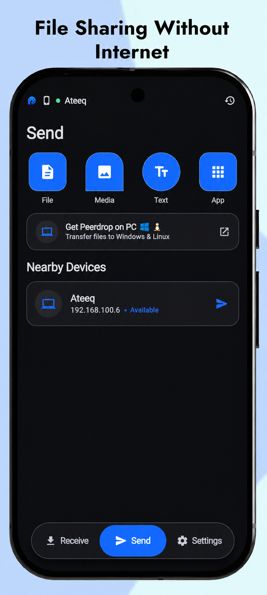
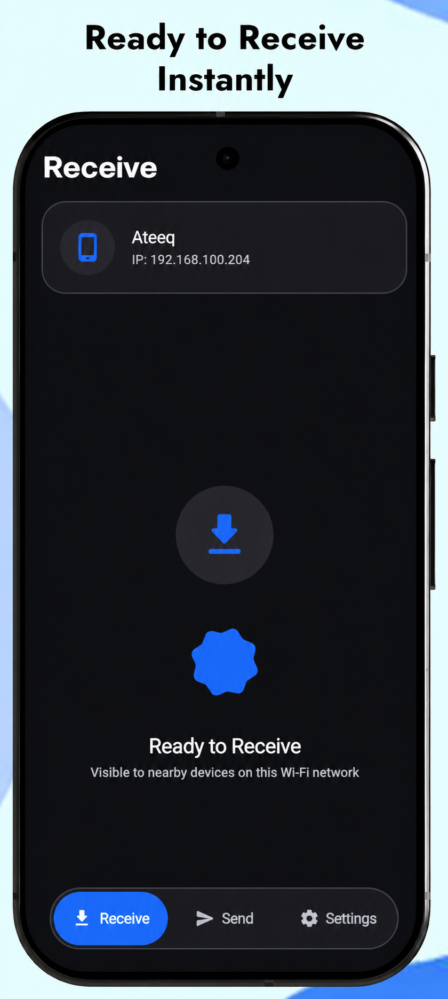

<div align="center">


# PeerDrop

### Fast, simple file sharing across your devices.

**Official downloads by Ateeq Develops**

<p>
  <a href="https://play.google.com/store/apps/details?id=com.ateeqdevelops.peerdrop">
    
  </a>
</p>

<p>
  <a href="https://ateeqdevelops.github.io/peerdrop/">Official Website</a> ·
  <a href="https://play.google.com/store/apps/details?id=com.ateeqdevelops.peerdrop">Android App</a> ·
  <a href="https://github.com/AteeqDevelops">Developer</a>
</p>

</div>

---

## About PeerDrop

**PeerDrop** is a file-transfer application from **Ateeq Develops** for moving files between supported devices. Use the Android app on Google Play and download the desktop installer for your computer from the official website.

This repository is the home for PeerDrop desktop download information and release assets.

> **Official Android listing:** [PeerDrop on Google Play](https://play.google.com/store/apps/details?id=com.ateeqdevelops.peerdrop)  
> **Official desktop download page:** [ateeqdevelops.github.io/peerdrop](https://ateeqdevelops.github.io/peerdrop/)

## App screenshots

The images below are stored in this repository so they appear directly in the GitHub README. Add the real screenshots from the PeerDrop Google Play listing to the `assets/` folder using the filenames shown here.

<div align="center">
  
  &nbsp;&nbsp;
  
  &nbsp;&nbsp;
  
</div>

## Downloads

Get the latest desktop installers from the official download page:

| Platform | Package | Download |
|---|---|---|
| Windows 64-bit | `.exe` installer | [Download PeerDrop for Windows](https://ateeqdevelops.github.io/peerdrop/) |
| Linux 64-bit (Debian/Ubuntu-based) | `.deb` package | [Download PeerDrop for Linux](https://ateeqdevelops.github.io/peerdrop/) |
| Android | Google Play app | [Install from Google Play](https://play.google.com/store/apps/details?id=com.ateeqdevelops.peerdrop) |

**Tip:** Visit the official download page for the current installer links and release information. Check the downloaded file name and make sure it came from an official Ateeq Develops link.

## Installation

### Windows

1. Open the [official PeerDrop download page](https://ateeqdevelops.github.io/peerdrop/).
2. Download the Windows `.exe` installer.
3. Open the downloaded installer and follow the on-screen instructions.
4. Launch PeerDrop from the Start menu.

If Windows displays a security prompt for an app that is not widely recognized, verify that you downloaded the installer from the official website before deciding whether to run it.

### Linux (Debian/Ubuntu-based distributions)

1. Open the [official PeerDrop download page](https://ateeqdevelops.github.io/peerdrop/).
2. Download the `.deb` package.
3. Open the package with your distribution's software installer, or install it from a terminal:

   ```bash
   sudo apt install ./peerdrop_1.0.0_amd64.deb
   ```

   Replace the filename with the exact name of the package you downloaded if it differs.

4. Launch PeerDrop from your applications menu.

### Android

Install PeerDrop from the official [Google Play listing](https://play.google.com/store/apps/details?id=com.ateeqdevelops.peerdrop).

## Supported platforms

- **Android:** Available on Google Play.
- **Windows:** Downloadable desktop installer.
- **Linux:** Debian package for compatible 64-bit systems.

Desktop package availability and system requirements can change between releases. Check the official website for the current builds.

## Project links

- **Website and desktop downloads:** https://ateeqdevelops.github.io/peerdrop/
- **Android on Google Play:** https://play.google.com/store/apps/details?id=com.ateeqdevelops.peerdrop
- **Developer portfolio:** https://ateeqdevelops.github.io/
- **GitHub developer profile:** https://github.com/AteeqDevelops

## Troubleshooting

- **Download looks stuck or shows an unknown total size:** Let the download finish and confirm the file appears in your browser's Downloads list. If it repeatedly fails, retry on a stable connection and use the official website.
- **Installer will not open:** Confirm that you downloaded the package for your operating system and CPU architecture.
- **Linux package fails to install:** Check that your distribution supports Debian `.deb` packages and that you downloaded the correct architecture.
- **Need help?** Use the links on the official website or contact the developer through the GitHub profile.

## About this repository

This repository is intended for PeerDrop release downloads and user-facing information. Installer binaries may be published as GitHub Release assets so each version can be identified and downloaded separately.

## Developer

**Ateeq Develops**

- Website: https://ateeqdevelops.github.io/
- GitHub: https://github.com/AteeqDevelops
- PeerDrop website: https://ateeqdevelops.github.io/peerdrop/

---

<div align="center">

**PeerDrop — File transfer made simple.**

</div>
