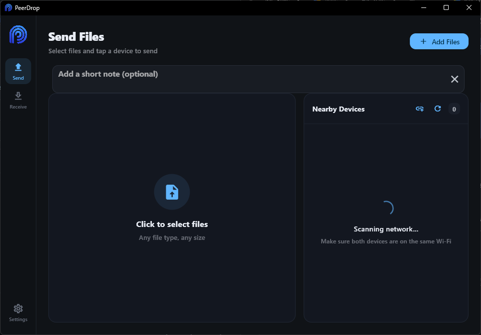
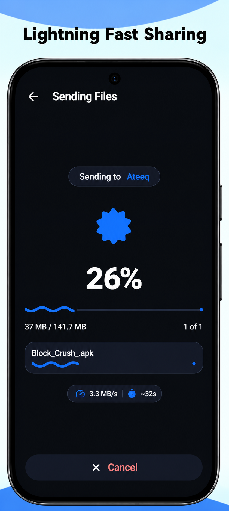

 

# PeerDrop

### Fast. Simple. Cross-platform File Transfer.

Transfer files between Android, Windows, and Linux devices with PeerDrop.

**Developed by Ateeq Develops**

[Google Play](https://play.google.com/store/apps/details?id=com.ateeqdevelops.peerdrop) · [Windows & Linux Downloads](https://ateeqdevelops.github.io/peerdrop/) · [Developer Website](https://ateeqdevelops.github.io/)

---

## Screenshots

### 1. PeerDrop for PC (Windows & Linux)

  

### 2. Android — Send Files

  

### 3. Android — Receive Files

  

### 4. Android — Settings

  

---

## Downloads

| Platform | Download |
|---|---|
| Windows | [Download Windows Installer (.exe)](https://ateeqdevelops.github.io/peerdrop/) |
| Linux | [Download Linux Package (.deb)](https://ateeqdevelops.github.io/peerdrop/) |
| Android | [Download from Google Play](https://play.google.com/store/apps/details?id=com.ateeqdevelops.peerdrop) |

## About PeerDrop

PeerDrop is a cross-platform file-sharing application designed to make transferring files between devices simple and convenient.

### Supported Platforms

- Android
- Windows
- Linux

### Features

- Cross-platform file sharing
- Simple and clean interface
- Send and receive files
- Desktop installers for Windows and Linux
- Android application available on Google Play

## Installation

### Windows

1. Visit the [official download page](https://ateeqdevelops.github.io/peerdrop/).
2. Download the Windows `.exe` installer.
3. Run the installer and follow the instructions.
4. Launch PeerDrop.

### Linux

1. Visit the [official download page](https://ateeqdevelops.github.io/peerdrop/).
2. Download the `.deb` package.
3. Install the package using your distribution's package installer.
4. Launch PeerDrop.

### Android

Install PeerDrop directly from [Google Play](https://play.google.com/store/apps/details?id=com.ateeqdevelops.peerdrop).

## Getting Started

1. Install PeerDrop on your devices.
2. Open the application on both devices.
3. Choose Send or Receive.
4. Follow the in-app instructions to transfer files.

## Troubleshooting

- Make sure devices are connected to the same local network when required.
- Check firewall settings if desktop devices cannot discover each other.
- Restart the application if a device is not appearing.
- Make sure you have installed the latest available version.

## Developer

**Ateeq Develops**

- Website: https://ateeqdevelops.github.io/
- PeerDrop Downloads: https://ateeqdevelops.github.io/peerdrop/
- Google Play: https://play.google.com/store/apps/details?id=com.ateeqdevelops.peerdrop

---

**PeerDrop — Share files. Stay connected.**

Made with ❤️ by Ateeq Develops

